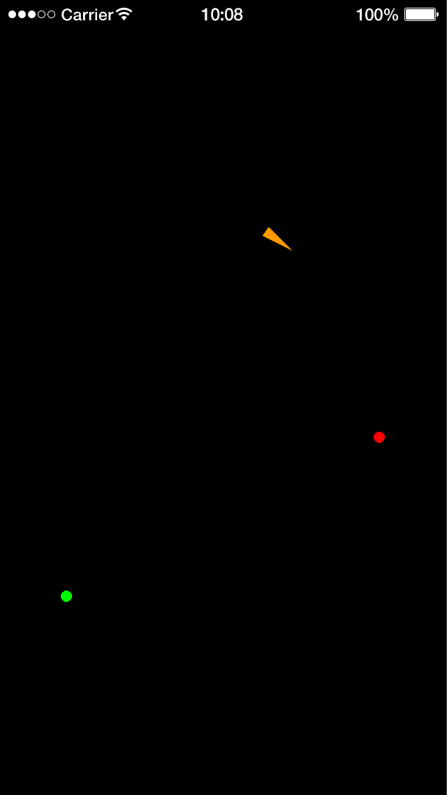

# dmc-trajectory

Parabolic motion for Solar2D (formerly Corona SDK): move a display object in an arc from one point to another, like a thrown ball or an arrow, in the time you choose.

```lua
local Trajectory = require( 'dmc_corona.dmc_trajectory' )

Trajectory.move( ball, { pBegin={ 50, 400 }, pEnd={ 270, 300 }, height=150, time=1500 } )
```

## Features

- Give the start, the end, how high the arc goes and how long it takes; dmc-trajectory works out the path
- Optionally turns the object along the path, for an object drawn facing right or left
- `Trajectory.calculate()` gives the speeds, the flight time and the starting angle without moving anything, to aim or set up first
- Pure Lua, no plugins or physics needed; MIT licensed

## Quick Start

The following code will get you up and running in about 10 minutes in the Solar2D Simulator on macOS or Windows. It flies an arrow in an arc to a target, again and again, turning it along the path.

Prerequisites: the [Solar2D](https://solar2d.com/) Simulator and a copy of this repository (`git clone https://github.com/dmccuskey/dmc-trajectory.git`, or download the ZIP from GitHub).

### 1. Copy the Library into Your Project

Copy these from this repository into the root of your project folder:

```text
dmc_corona_boot.lua     loader for the DMC libraries
dmc_corona.cfg          configuration
dmc_corona/             dmc-trajectory
```

**Going further:** keep the libraries in a subfolder, or combine several DMC libraries ([dmc-corona-boot Configuration](https://github.com/dmccuskey/dmc-corona-boot/blob/master/docs/configuration.md)).

### 2. Fly an Arrow

Create `main.lua` in the project folder:

```lua
local Trajectory = require( 'dmc_corona.dmc_trajectory' )

local W, H = display.contentWidth, display.contentHeight
local START, TARGET = { W*0.15, H*0.75 }, { W*0.85, H*0.55 }

-- the start and target points
display.newCircle( START[1], START[2], 8 ):setFillColor( 0, 1, 0 )
display.newCircle( TARGET[1], TARGET[2], 8 ):setFillColor( 1, 0, 0 )

-- an arrow, drawn pointing right
local arrow = display.newPolygon( 0, 0, { -24,-8, 24,0, -24,8 } )
arrow:setFillColor( 1, 0.6, 0 )

-- fly the arrow in an arc to the target, 300 above the higher point,
-- turning it along the path; then again, after a short pause
local function fly()
	arrow.x, arrow.y = START[1], START[2]
	Trajectory.move( arrow, {
		pBegin=START, pEnd=TARGET, height=300, time=1500, rotate=true,
		onComplete=function() timer.performWithDelay( 500, fly ) end
	} )
end

fly()
```

Open the project in the Simulator. An orange arrow flies from the green point up over the screen and down onto the red one, pointing the way it moves, every two seconds:



If the console shows `module 'dmc_corona.dmc_trajectory' not found` instead, `dmc_corona/` is missing from the root of the project folder. Require it by that full name: `require( 'dmc_trajectory' )` fails, because the loader that finds the DMC libraries runs only once dmc-trajectory is loading.

**Going further:** the [examples](examples/README.md) fly several objects at once, and objects drawn facing left or right.

To update, copy `dmc_corona_boot.lua` and `dmc_corona/` again from the newer version.

## API

```lua
local Trajectory = require( 'dmc_corona.dmc_trajectory' )
```

`Trajectory.VERSION` is the version. Positions and the height are in content units, with `y` down, as on screen.

### Trajectory.move( obj, params )

Moves `obj`, a display object, along the arc, one step each frame, setting its `x` and `y` (and `rotation` with `rotate`). Returns nothing. `params`:

| key | type | |
|---|---|---|
| `pBegin` | table `{ x, y }` | where the arc starts. The object is put there on the first frame |
| `pEnd` | table `{ x, y }` | where it ends. The object is put exactly there at the end |
| `height` | number, 0 or more | how far the top of the arc is above the higher of the two points. 0 with the end lower is a fall from the start; points at the same height need more than 0 |
| `time` | number, 0 or more | how long the move takes, in milliseconds. The path doesn't depend on it |
| `rotate` | boolean, optional | turn the object along the path; default `false` |
| `direction` | `'right'` or `'left'`, optional | which way the object is drawn facing, for `rotate`; default `'right'` |
| `onComplete` | function, optional | called with no arguments when the object reaches `pEnd` |

A move stops when the object is removed (`obj:removeSelf()`), without calling `onComplete`. Missing or wrong `params` raise an error at your call, such as `dmc_trajectory: height must be a number, 0 or more`.

### Trajectory.calculate( params )

Works out the arc for `pBegin`, `pEnd`, `height` and `direction`, as in `move()`, without moving anything. Returns a table:

| key | |
|---|---|
| `Vx`, `Vy` | the starting speeds, across and up |
| `time` | the time in the air, in the arc's own units (not milliseconds: `move()` scales it to its `time`) |
| `angle` | the `rotation` the object starts with, for its `direction` |

The [direction example](examples/README.md) uses it to point each projectile before it flies.

### The Formulas

`calculate()` uses these, with gravity 9.8 and `y` up; you can call them too:

| function | returns |
|---|---|
| `Trajectory.Vy_Given_h( h )` | the upward speed that rises `h` |
| `Trajectory.t_Given_Vy_pB_pE( Vy, pB, pE )` | the time from `pB` to `pE`'s height, starting at `Vy` |
| `Trajectory.Vx_Given_t_pB_pE( t, pB, pE )` | the speed across that covers `pB` to `pE` in `t` |
| `Trajectory.x_Given_vx_t( Vx, t )` | the distance across after `t` |
| `Trajectory.y_Given_vy_t( Vy, t )` | the height after `t` |

The physics behind them: [Trajectories](http://hyperphysics.phy-astr.gsu.edu/hbase/traj.html) (HyperPhysics), [Projectile motion](https://en.wikipedia.org/wiki/Projectile_motion) (Wikipedia), and [Projectile Motion](https://web.archive.org/web/20080419171140/http://library.thinkquest.org/10139/small/proj1.html) (ThinkQuest, on the Wayback Machine).

## Known Issues

- A move can't be stopped, paused or changed once started, except by removing the object ([#1](https://github.com/dmccuskey/dmc-trajectory/issues/1)).

The changes in each version are in the [CHANGELOG](CHANGELOG.md).

## Development

Only `dmc_corona/dmc_trajectory.lua` is written in this repository; it needs no other module. `dmc_corona_boot.lua`, and the copies in each example, are generated by Snakemake from sibling checkouts (`../dmc-corona-boot`, `../DMC-Corona-Library` for the shared rules); fix the source, then rebuild. From this repository's root folder:

```sh
snakemake --cores 1 build_all
```

The unit tests run in plain Lua 5.1, with a stand-in for Solar2D's `Runtime`:

```sh
tests/run_unit.sh
```

They need Lua 5.1 and dkjson; `LUA=` names the interpreter. The Quick Start and the examples are the check that it works in Solar2D.

## License

dmc-trajectory is released under the [MIT License](LICENSE).
