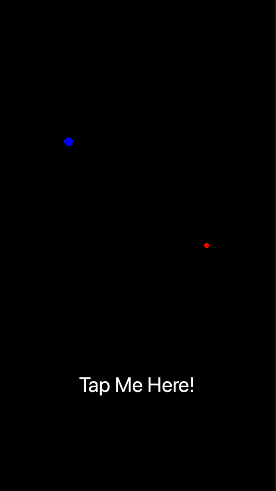
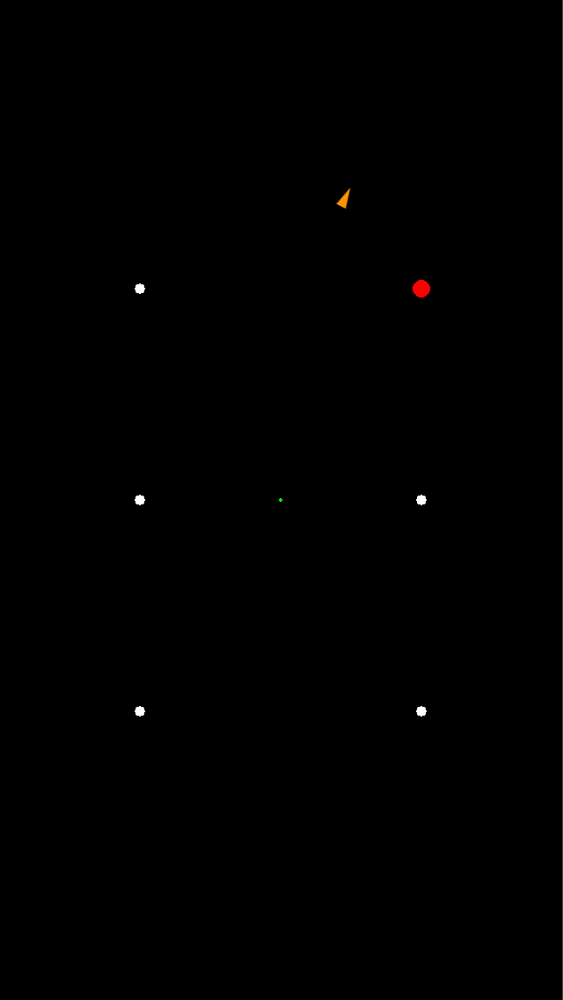
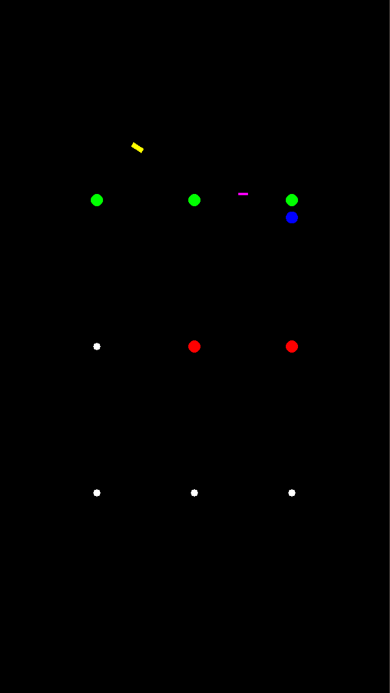

# Examples

Each folder is a complete Solar2D project with its own copy of the library: open its `main.lua` in the Solar2D Simulator.

| | |
|---|---|
|  | **dmc-trajectory-basic**: tap "Tap Me Here!" and a blue ball flies from the green point to the red one in a low arc, then starts again. |
|  | **dmc-trajectory-direction**: projectiles fly from the center to a random point of the grid, at a random height and speed, one after another. Some are drawn facing left, some right; `direction` tells `rotate` which, and `Trajectory.calculate()` points each one before it flies. |
|  | **dmc-trajectory-multiple**: several moves at once, between random points of the grid: a blue ball, then a magenta bar after 10 seconds and a yellow bar after 20, the bars turning along their paths. |
